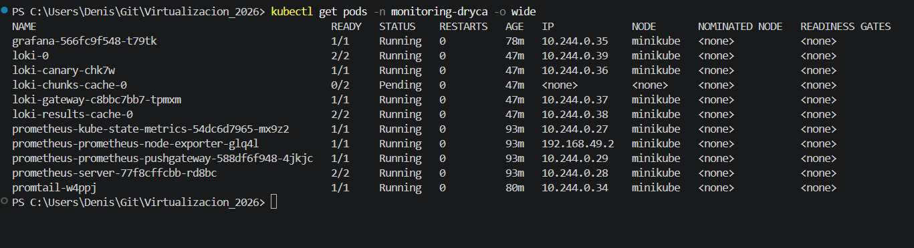
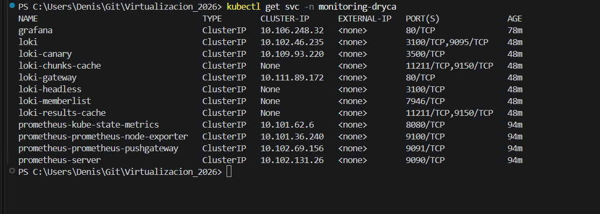
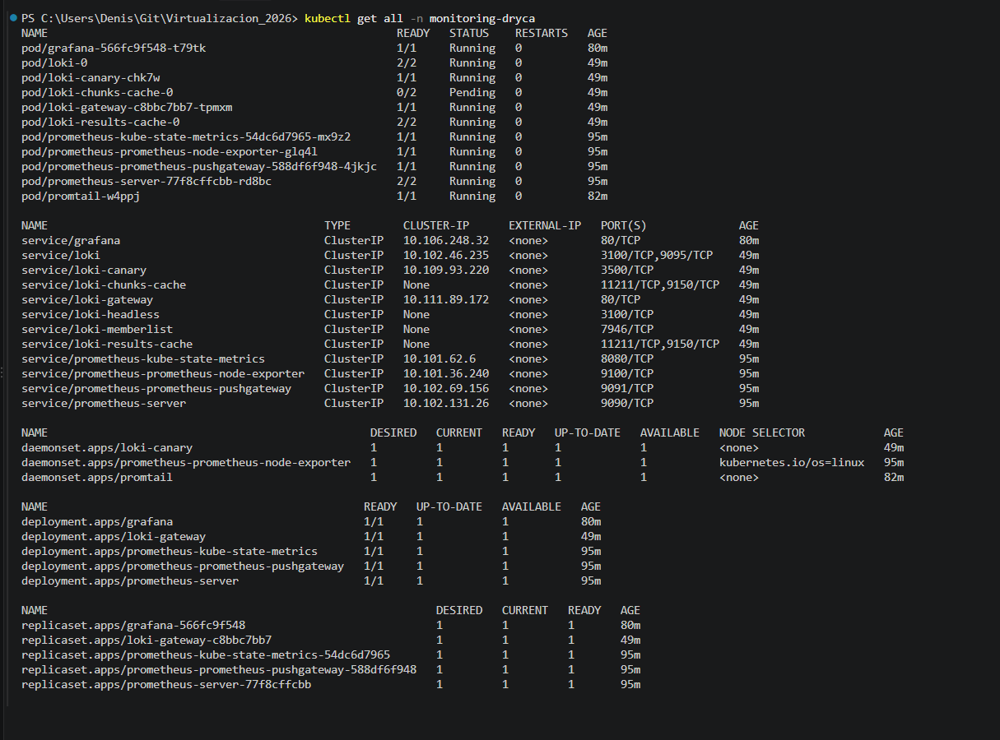

# Virtualizacion
# Proyecto Personal I - Monitoreo y Centralización de Logs

Implementación de un sistema integral de observabilidad y centralización de registros dentro de un clúster de Kubernetes (**Minikube**) utilizando **Prometheus**, **Loki**, **Promtail** y **Grafana**, expuestos mediante el Ingress Controller **Traefik** y el balanceador de carga **MetalLB**.


---

## 1. Identificación y Parámetros del Entorno

* **Namespace de monitoreo:** `monitoring-dryca`
* **Namespace de aplicaciones a monitorear:** `parcial-dryca`
* **Dominios DNS locales configurados:**
  * Grafana: `http://grafana.dryca.local`
  * Prometheus: `http://prometheus.dryca.local`

* ** CREAR EL TUNEL PARA MINIKUBE, DEJAR ENCENDIDO(NO CERRAR LA TERMINAL)
    ``` 
    minikube tunnel
---
## 2. Estructura del Repositorio (IaC)

Toda la infraestructura y configuración de observabilidad se gestiona de forma declarativa:

```text
.
├── monitoring/
│   ├── helm-values/
│   │   ├── prometheus-values.yaml
│   │   ├── loki-values.yaml
│   │   ├── promtail-values.yaml
│   │   └── grafana-values.yaml
│   ├── dashboards/
│   │   ├── cluster-metrics.json
│   │   └── apps-logs.json
│   └── traefik-ingress/
│       └── monitoring-ingress.yaml
│       └──ingress-routes.yaml
├── capturas
└── README.md
```

---

## 3. Guía de Instalación y Despliegue Declarativo

### 3.1. Creación del Namespace Único
```bash
kubectl create namespace monitoring-dryca
```

### 3.2. Repositorios de Helm Requeridos
```bash
helm repo add prometheus-community https://prometheus-community.github.io/helm-charts
helm repo add grafana https://grafana.github.io/helm-charts
helm repo update
```

### 3.3. Instalación de Prometheus
Se instaló el chart de Prometheus configurado para recolectar métricas del clúster con `node-exporter` y `kube-state-metrics`:
```bash
helm install prometheus prometheus-community/prometheus \
  --namespace monitoring-dryca \
  -f monitoring/helm-values/prometheus-values.yaml
```

### 3.4. Instalación de Loki
Desplegado en modo `SingleBinary` para compatibilidad y uso eficiente de almacenamiento en entorno local:
```bash
helm install loki grafana/loki \
  --namespace monitoring-dryca \
  -f monitoring/helm-values/loki-values.yaml
```

### 3.5. Instalación de Promtail (DaemonSet)
Promtail recolecta los logs en `/var/log/pods` aplicando filtros y relabeling específico para extraer logs de los contenedores del namespace `parcial-dryca` y de `traefik`:
```bash
helm install promtail grafana/promtail \
  --namespace monitoring-dryca \
  -f monitoring/helm-values/promtail-values.yaml
```

### 3.6. Instalación y Provisioning de Grafana
Grafana aprovisiona automáticamente por código (`values.yaml`):
* Data sources: Prometheus (`http://prometheus-server:9090`) y Loki (`http://loki:3100`).
* Dashboards: Tableros declarativos inyectados como JSON sin intervención manual en la interfaz.

```bash
helm install grafana grafana/grafana \
  --namespace monitoring-dryca \
  -f monitoring/helm-values/grafana-values.yaml
```

---

## 4. Exposición de Servicios con Traefik y MetalLB

### 4.1. Definición del Ingress
Se aplicó el manifiesto Ingress con `ingressClassName: traefik` para direccionar el tráfico entrante de los hosts a los servicios internos:
```bash
kubectl apply -f monitoring/traefik-ingress/monitoring-ingress.yaml
```

### 4.2. Resolución DNS Local (`/etc/hosts`)
Se obtuvo la `EXTERNAL-IP` asignada por MetalLB al servicio de Traefik:
```bash
kubectl get svc -n traefik
```

Se añadieron las siguientes entradas al archivo `hosts` (`/etc/hosts` en Linux o `C:\Windows\System32\drivers\etc\hosts` en Windows):
```text
<EXTERNAL-IP-METALLB> grafana.dryca.local prometheus.dryca.local
```

*(En Windows, se ejecutó `minikube tunnel` en una consola con privilegios elevados para enrutar el tráfico al LoadBalancer).*

---


## 5. Evidencias de Funcionamiento

### 5.1. Acceso a Prometheus por Nombre de Dominio
Acceso verificado a `http://prometheus.dryca.local` enrutado correctamente por Traefik:

.png>)

---

### 5.2. Estado de Targets en Prometheus (Targets en estado UP)
Evidencia de los componentes del clúster recolectados con estado verde / UP en la sección **Status > Targets**:

.png>)

---

### 5.3. Acceso a Grafana por Nombre de Dominio
Acceso al portal de Grafana a través de `http://grafana.dryca.local`:

.png>)

---

### 5.4. Dashboard de Métricas del Clúster
Visualización de métricas de CPU, memoria y conteo del estado de pods en tiempo real:

.png>)

---

### 5.5. Dashboard de Logs Centralizados (Loki)
Visualización de los logs de las 4 aplicaciones alojadas en el namespace `parcial-dryca`, consultados a través del Data Source de Loki mediante `{namespace="parcial-dryca"}`:

.png>)

### EXTRAS





