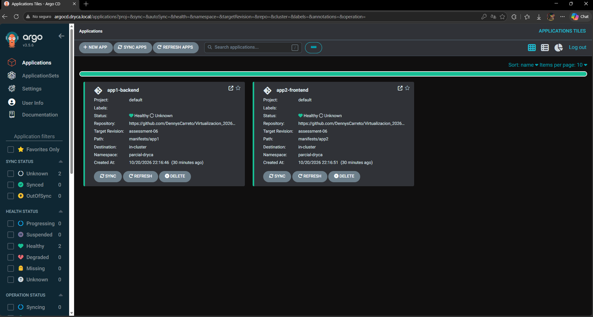

# Virtualizacion
# Tarea 06 - Despliegue GitOps con Argo CD

Este proyecto documenta la instalación, configuración y exposición de **Argo CD** en un clúster local de Minikube, así como el despliegue y sincronización continua de aplicaciones bajo la filosofía GitOps.

- **Iniciales:** DRYCA
- **Rama:** `assessment-06`
- **Namespace de Argo CD:** `argocd-dryca`
- **Namespace de Aplicaciones:** `parcial-dryca`

## 1. Estructura del Proyecto

```text
Virtualizacion_2026/
├── argo_apps/
│   ├── app1-application.yaml
│   └── app2-application.yaml
├── manifests/
│   ├── app1/
│   │   └── deployment.yaml
│   └── app2/
│       └── deployment.yaml
├── traefik-argocd/
│   └── ingressroute.yaml
├── README.md
└── capturas/
```

---

## 2. Instalación y Configuración de Argo CD

### A. Creación del Namespace y Despliegue Oficial
Se creó el namespace propio asignado (`argocd-dryca`) y se aplicaron los manifiestos base oficiales de Argo CD:

```powershell
# 1. Crear namespace personalizado
kubectl create namespace argocd-dryca

# 2. Instalar Argo CD
kubectl apply -n argocd-dryca -f https://raw.githubusercontent.com/argoproj/argo-cd/stable/manifests/install.yaml
```

### B. Configuración de Permisos RBAC (ClusterRoleBinding)
Al encontrarse en un namespace diferente al predeterminado (`argocd`), se asignaron los permisos requeridos al controlador de Argo CD para que pudiera inspeccionar y desplegar recursos en namespaces externos (`parcial-dryca`):

```powershell
kubectl create clusterrolebinding argocd-controller-admin --clusterrole=cluster-admin --serviceaccount=argocd-dryca:argocd-application-controller
```

### C. Desactivación de TLS Interno (`--insecure`)
Para permitir que Traefik gestione la capa de enrutamiento sin conflictos con el certificado autofirmado interno de Argo CD, se actualizó la configuración en el ConfigMap `argocd-cmd-params-cm`:

```powershell
kubectl patch configmap argocd-cmd-params-cm -n argocd-dryca --type merge -p '{\"data\":{\"server.insecure\":\"true\"}}'
kubectl rollout restart deployment argocd-server -n argocd-dryca
```

---

## 3. Exposición mediante Traefik y Nombre de Dominio

### A. Definición del `IngressRoute` de Traefik
Se creó el manifiesto en `traefik-argocd/ingressroute.yaml` vinculando el host `argocd.dryca.local` con el servicio `argocd-server` en el puerto 80:

```yaml
apiVersion: traefik.io/v1alpha1
kind: IngressRoute
metadata:
  name: argocd-server-ingressroute
  namespace: argocd-dryca
spec:
  entryPoints:
    - web
    - websecure
  routes:
    - match: Host(`argocd.dryca.local`)
      kind: Rule
      services:
        - name: argocd-server
          port: 80
```

Se aplicó el manifiesto al clúster:
```powershell
kubectl apply -f traefik-argocd/ingressroute.yaml
```

### B. Mapeo en el archivo Hosts y Túnel de Minikube
Debido al uso de Minikube con el driver de Docker en Windows, el servicio LoadBalancer de Traefik fue expuesto mediante:

```powershell
minikube tunnel
```

En el archivo de resolución de nombres de Windows (`C:\Windows\System32\drivers\etc\hosts`) se agregó la siguiente entrada:

```text
127.0.0.1    argocd.dryca.local
```

### C. Credenciales de Administrador
Se extrajo y decodificó la contraseña por defecto del usuario `admin`:

```powershell
$pass = kubectl -n argocd-dryca get secret argocd-initial-admin-secret -o jsonpath="{.data.password}"
[System.Text.Encoding]::UTF8.GetString([System.Convert]::FromBase64String($pass))
```

### Evidencia: Acceso a la Interfaz Web con Dominio *LOGIN EXITOSO*



---

## 4. Creación de las `Application` y Despliegue GitOps

Se definieron dos aplicaciones de Argo CD que monitorean la rama `assessment-06` y despliegan los manifiestos en el namespace de destino `parcial-dryca`.

### A. Definición de `app1-backend` (`argo_apps/app1-application.yaml`)
```yaml
apiVersion: argoproj.io/v1alpha1
kind: Application
metadata:
  name: app1-backend
  namespace: argocd-dryca
spec:
  project: default
  source:
    repoURL: 'https://github.com/DennysCarreto/Virtualizacion_2026.git'
    targetRevision: assessment-06
    path: manifests/app1
  destination:
    server: 'https://kubernetes.default.svc'
    namespace: parcial-dryca
  syncPolicy:
    automated:
      prune: true
      selfHeal: true
    syncOptions:
    - CreateNamespace=true
```

### B. Definición de `app2-frontend` (`argo_apps/app2-application.yaml`)
```yaml
apiVersion: argoproj.io/v1alpha1
kind: Application
metadata:
  name: app2-frontend
  namespace: argocd-dryca
spec:
  project: default
  source:
    repoURL: 'https://github.com/DennysCarreto/Virtualizacion_2026.git'
    targetRevision: assessment-06
    path: manifests/app2
  destination:
    server: 'https://kubernetes.default.svc'
    namespace: parcial-dryca
  syncPolicy:
    automated:
      prune: true
      selfHeal: true
    syncOptions:
    - CreateNamespace=true
```

Se aplicaron los recursos al clúster:
```powershell
kubectl apply -f argo_apps/app1-application.yaml
kubectl apply -f argo_apps/app2-application.yaml
```

### Evidencias: Aplicaciones en Estado Synced y Healthy
*Vista general de las dos aplicaciones:*


*Detalle y topología de recursos de `app1-backend` (2 réplicas iniciales):*


---

## 5. Sincronización Automática tras Cambio en el Repositorio

Para validar la sincronización de GitOps en el clúster:

1. Se editó el archivo `manifests/app1/deployment.yaml`, modificando la propiedad `replicas` de **2** a **4**:
   ```yaml
   spec:
     replicas: 4
   ```
2. Se subió el cambio a GitHub en la rama `assessment-06`:
   ```powershell
   git add manifests/app1/deployment.yaml
   git commit -m "chore: scale app1-backend replicas from 2 to 4"
   git push origin assessment-06
   ```
3. Argo CD detectó el nuevo commit en el repositorio y procedió a sincronizar el estado deseado de forma automática, escalando el Deployment a 4 pods en el namespace `parcial-dryca`.

### Evidencia: Sincronización y Nuevo Estado
*Aplicación `app1-backend` con 4 réplicas en estado Synced y Healthy:*


Comprobación en terminal:
```powershell
kubectl get pods -n parcial-dryca
```